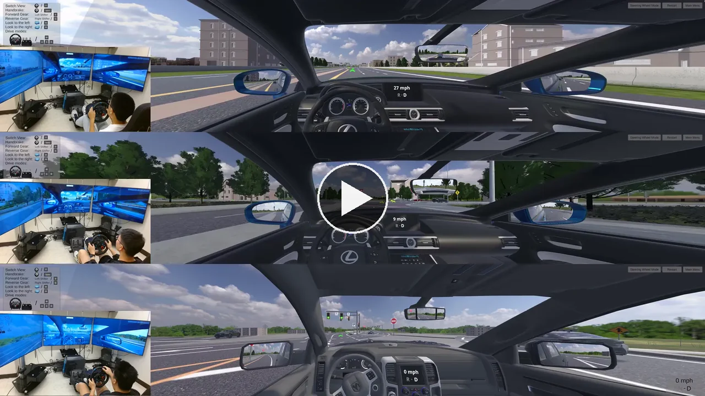
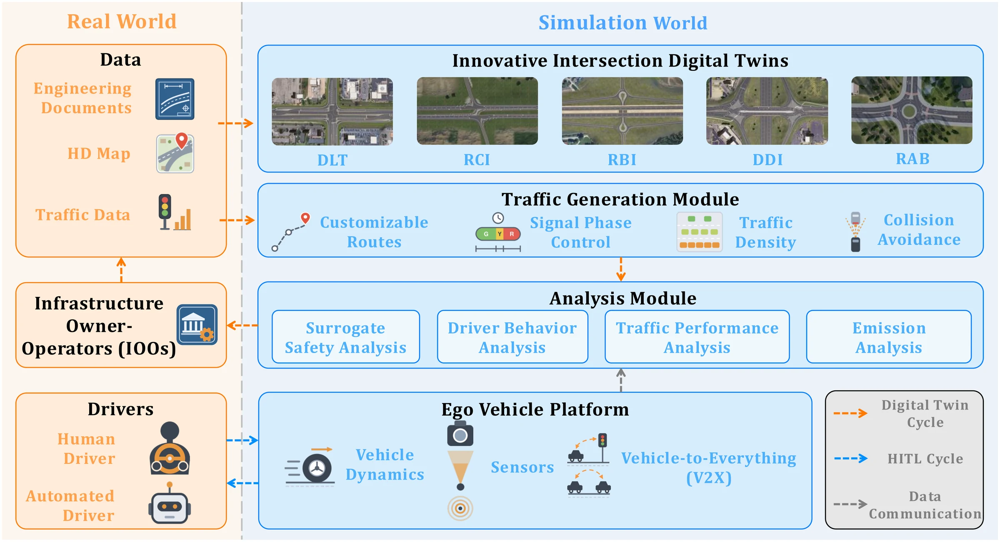

# InterSim

**InterSim: Innovative Intersection Digital Twins for Human-in-the-Loop Driving Simulation**

[](https://purduedigitaltwin.github.io/intersim/)
[](#)
[](https://unity.com/releases/editor/archive)
[](https://zenodo.org/records/23889549)
[](LICENSE)

InterSim is a Unity-based human-in-the-loop driving simulator with digital twins of five innovative intersections: Displaced Left Turn (DLT), Reduced Conflict Intersection (RCI), Roundabout Interchange (RBI), Diverging Diamond Interchange (DDI) and Two-Lane Roundabout (RAB).

Paper: coming soon.

## Showcase

### Demo video

[](https://purduedigitaltwin.github.io/intersim/#video)

### System architecture



- **Digital twin cycle (orange):** design documents, HD maps and traffic data from infrastructure owner-operators (IOOs) are used to rebuild each intersection in Unity, with traffic generated on its routes and signals. Simulation results (surrogate safety, driver behavior, traffic performance, emissions) go back to the IOOs to guide a revised design.
- **Human-in-the-loop cycle (blue):** a human driver (steering wheel and pedals, keyboard or gamepad) or an automated agent drives the ego vehicle, which has tunable vehicle dynamics, sensors and V2X. The driver gets visual and steering feedback in real time, and vehicle states and driver inputs are logged for analysis.

## How to use

### Run the prebuilt simulator

1. Open the [Releases](https://github.com/PurdueDigitalTwin/InterSim-Simulator/releases) page and download the package for your system.
2. Extract it and start the simulator:
   - **Windows:** run `InterSim.exe`. If SmartScreen warns about an unknown app, click *More info* → *Run anyway*.
   - **Linux:** run `./InterSim.x86_64` from the extracted folder.
   - **macOS:** the app is not signed, so run `xattr -dr com.apple.quarantine InterSim.app` in Terminal once, then open `InterSim.app`.
3. In the main menu, pick an intersection and a vehicle. A steering wheel with pedals is recommended (we use a Logitech G29); keyboard control also works.

### Open the Unity project

This repository has the scripts, scenes, prefabs, materials and project settings, but not the textures, 3D models or audio. Those files are left out because of TurboSquid license restrictions on the vehicle 3D models and textures (see [Notes](#notes)) and because of file size limits. You can still clone this repository and open it in Unity to look at the code and scenes, but surfaces have no textures, and the vehicle and intersection models don't appear. The complete Unity project is on Zenodo, and downloading it requires our approval. If you only want to try a working demo of the simulator, download a prebuilt package from [Releases](https://github.com/PurdueDigitalTwin/InterSim-Simulator/releases) instead (see [Run the prebuilt simulator](#run-the-prebuilt-simulator)).

1. Request access to the [InterSim Zenodo record](https://zenodo.org/records/23889549). Once your request is approved, download `InterSim-FullProject.zip` (about 5 GB) and extract it.
2. Install [Unity Hub](https://unity.com/download). In Unity Hub, click *Add* → *Add project from disk* and select the extracted `InterSim` folder. Unity Hub will offer to install the required editor version (6000.6.6f1).
3. Open the project. The first import takes a while because Unity rebuilds its `Library` cache.
4. Open `Assets/Scenes/Main/MainMenu.unity` and press **Play**. The five intersection scenes are in the same folder.

To get later updates from this repository, connect the extracted project to it once (requires [Git](https://git-scm.com/)):

```bash
cd InterSim
git init -b main
git remote add origin https://github.com/PurdueDigitalTwin/InterSim-Simulator.git
git fetch origin
git reset origin/main
git branch -u origin/main
```

After that, `git pull` updates the scripts, scenes and settings, and the textures and models from Zenodo stay in place.

## Notes

The vehicle models in the Zenodo project (the meshes and textures in `Assets/Models/Vehicles`) are commercial 3D models purchased from TurboSquid. This is why the Zenodo files are restricted: request access there, and we approve requests for research use. **Please do not redistribute the vehicle models.** The prebuilt packages in Releases already include the vehicles. For questions about access or the vehicle models, please contact Luyang Jiang ([luyang@purdue.edu](mailto:luyang@purdue.edu)).

## Citation

```bibtex
@misc{jiang2026intersim,
  title  = {InterSim: Innovative Intersection Digital Twins for
            Human-in-the-Loop Driving Simulation},
  author = {Jiang, Luyang and Wei, Chuheng and Li, Yaguang and
            Wang, Shaoqi and Zhou, Yupeng and Yun, Hyunsoo and
            Liao, Xishun and Pitts, Brandon and Wang, Ziran},
  year   = {2026}
}
```

## License

The InterSim code is released under the [MIT License](LICENSE). The vehicle models and the third-party assets and packages in `Assets/` (for example EasyRoads3D, Edy's Vehicle Physics, Simple Waypoint System, Traffic Lights System, TerrainFormer, DOTween and Unity Standard Assets) remain under their own licenses.

## Acknowledgement

This work was supported by the Indiana Department of Transportation (INDOT) Joint Transportation Research Program (JTRP) under Grant JTRP-4932.
